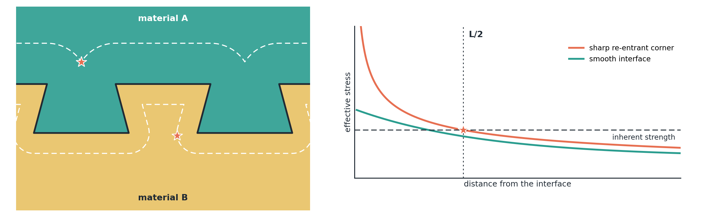
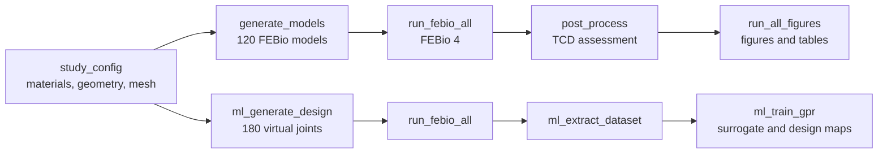

<h1 align="center">bimaterial-interlock-tcd</h1>

<p align="center">
  <b>Design of interlocking interfaces for multi-material additive manufacturing<br>using finite element analysis and the Theory of Critical Distances</b>
</p>

<p align="center">
  
  
  
  
</p>

<p align="center">
  
</p>

---

Multi-material 3D printing joins dissimilar polymers through interlocking interfaces, but the sharp corners that provide locking produce singular stress fields that make peak-stress predictions mesh-dependent. This repository contains the workflow used in the accompanying article to predict the static strength of such interfaces from the material properties and the interface geometry. The underlying formulation, including the bi-material corner singularities, the closed-form interfacial tractions, the generalized Point Method and the similarity argument behind the surrogate, is given in Section 2 of the article.

**What the workflow does**

- builds parametric **sinusoidal, triangular and dovetail** interfaces at any scale and writes interface-conforming FEBio models in which both materials share all interface nodes
- evaluates a **generalized Point Method** of the Theory of Critical Distances on a locus of points at half the critical distance from the whole interface, separately in each material
- runs a **verification suite**: mono-material references, linearity, mesh convergence with the grid convergence index, and a comparison with penalty-based tied contact
- trains a **Gaussian-process surrogate** on a Latin hypercube design of virtual material pairs and turns it into design maps of the admissible feature size

No results are stored in the repository. Every number and figure of the article is regenerated on your computer.



## Requirements

| Software | Version | Needed for |
|---|---|---|
| MATLAB | R2020a or newer | everything except the solver |
| Statistics and Machine Learning Toolbox | recent | surrogate training only (`fitrgp`) |
| [FEBio](https://febio.org) | 4.x, command-line solver `febio4` | finite element analyses |
| Python with numpy and scipy | 3.9 or newer, optional | independent verification solver in `tools/` |

FEBio Studio installs the command-line solver next to the graphical interface, for example `C:\Program Files\FEBioStudio\bin\febio4.exe`. Use that file, not `FEBioStudio.exe`.

## Quick start

Clone the repository and open MATLAB in its folder.

```bash
git clone https://github.com/<your-username>/bimaterial-interlock-tcd.git
```

**1. Generate the models** (a few minutes)

```matlab
generate_models            % writes febio_models/ with 120 .feb files
```

**2. Test the solver on one model**

```matlab
run_febio_all('febio_models', 1)
```

The solver is found automatically in the usual installation folders. If it is not, pass its path:

```matlab
run_febio_all('febio_models', 1, 'C:\Program Files\FEBioStudio\bin\febio4.exe')
```

**3. Solve all models** (about 20 s per model on a desktop computer, roughly 40 min in total)

```matlab
run_febio_all('febio_models')
```

Solved models are skipped, so the run can be interrupted and restarted at any time.

**4. Evaluate the joints**

```matlab
post_process               % results.mat, results_table.csv and a verification summary
```

**5. Produce the figures**

```matlab
run_all_figures            % figures/ : PNG (600 dpi) plus EPS and PDF for the contour plots
```

### Optional: interface modeling comparison

```matlab
gen_tied_comparison        % 8 models with penalty tied contact
run_febio_all('tied_models')
tied_compare               % adds panels (g) to (i) to the verification figure
```

### Optional: surrogate model and design maps

```matlab
addpath('ml')
ml_generate_design         % 180 virtual bi-material joints
run_febio_all('ml_models') % about 1 h
ml_extract_dataset         % 4320 training samples
ml_train_gpr               % cross-validation, validation, sensitivity and design maps
```

`export_paper_figures` finally copies all figures to `figures_paper/` with the numbering of the article.

## Using your own materials or geometries

All parameters are defined in `study_config.m`. The most useful entries are:

| Field | Meaning |
|---|---|
| `cfg.mat(k)` | material name, Young's modulus `E` (MPa), Poisson's ratio `nu`, inherent strength `sigma0` (MPa) and fracture toughness `KIc` (MPa m^0.5) |
| `cfg.topologies` | interface profiles to analyze |
| `cfg.scales` | self-similar scale factors; wavelength 2.0*s* mm, amplitude 0.3*s* mm |
| `cfg.dovetail_undercut_deg` | undercut angle of the dovetail flanks |
| `cfg.h_prod`, `cfg.growth` | element size at the corners and growth ratio |
| `cfg.eps_ref` | nominal strain of the linear-elastic reference state |

The critical distance of each material is computed from `KIc` and `sigma0`. Material data should come from printed specimens produced with one set of printing parameters, since mixing sources gives an inconsistent length scale.

## Outputs

The workflow writes its results to `febio_models/`, `ml_models/`, `tied_models/` and `figures/`. A description of every file and column is given in [`docs/OUTPUTS.md`](docs/OUTPUTS.md).

## Repository structure

| Path | Content |
|---|---|
| `study_config.m` | all parameters |
| `build_mesh.m`, `graded_nodes.m`, `graded_depth.m` | parametric interfaces and interface-conforming meshes |
| `generate_models.m`, `write_feb.m`, `run_febio_all.m` | FEBio input files and batch solution |
| `post_process.m`, `evaluate_case.m`, `tcd_locus.m`, `interp_centroids.m` | generalized Point Method and competing criterion |
| `make_tied_mesh.m`, `gen_tied_comparison.m`, `tied_compare.m` | tied-contact comparison |
| `ml/` | Latin hypercube design, dataset extraction, Gaussian-process training, design maps |
| `figures_src/`, `make_figures.m`, `run_all_figures.m` | figure scripts and plotting helpers |
| `tools/independent_solver.py` | independent linear plane-strain solver for solution verification |
| `docs/OUTPUTS.md` | description of all generated files |

## Troubleshooting

| Message | Solution |
|---|---|
| `FEBioStudio.exe is the GUI, not the solver` | pass the path of `febio4.exe` from the same folder |
| `FEBio solver not found` | pass the solver path as the third argument of `run_febio_all` |
| a model is reported as `FAILED` | the last lines of the FEBio output are printed; rerun `run_febio_all`, solved models are skipped |
| `fitrgp` is undefined | install the Statistics and Machine Learning Toolbox; all other steps run without it |

Model generation and post-processing also run in GNU Octave 8 or newer.

## Citation

If you use this workflow, please cite the article and this repository. GitHub shows the citation under **Cite this repository**, based on `CITATION.cff`.

> F.H. Öztürk, *Design of interlocking interfaces for multi-material additive manufacturing using finite element analysis and the Theory of Critical Distances*, Computer-Aided Design (submitted).

## License

MIT License, see [`LICENSE`](LICENSE).

## Contact

Fatih Huzeyfe Öztürk, Department of Mechanical Engineering, Karabük University, Türkiye
fhozturk@karabuk.edu.tr
